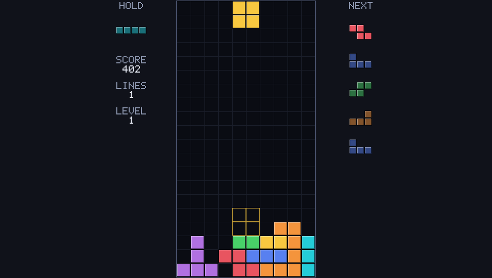

# STACKFALL

An offline block-stacking game for the Anbernic RG503, with procedural graphics and synthesized sound.



Clear lines, keep room for the next piece, and chase your high score as the game gets faster.
Hold a piece for later, plan around five previews, and use the ghost outline to place each drop.

The desktop build is playable with a keyboard or controller.
The handheld target is the RG503 running ROCKNIX through PortMaster.
The PortMaster package is assembled and checked locally; testing on the
device and publication remain unfinished.

## Play on desktop

You need a C++17 compiler, CMake 3.16 or later, and Ninja.
Install the development files for Simple DirectMedia Layer (SDL) 2.

1. Configure and build:

   ```sh
   cmake -S . -B build -G Ninja -DCMAKE_BUILD_TYPE=Release
   cmake --build build
   ```

2. Start the game:

   ```sh
   ./build/stackfall
   ```

3. Select **Start Game**. Open **Controls** from the title screen to see the
   bindings, and press **Enter** or **A** there to change them. Open
   **Options** to change the sound, ghost outline, board grid, hold
   preview, Next preview count, grayscale play scene, and screen
   orientation, and open **Music** from there for the soundtrack settings.

### Controls

| Action | Keyboard | Controller |
| --- | --- | --- |
| Move | Left / Right | D-pad left / right |
| Soft drop | Down | D-pad down |
| Rotate clockwise | X / Up | A |
| Rotate counterclockwise | Z | B |
| Hard drop | Space | D-pad up |
| Hold | C / Left Shift | Y / Left shoulder |
| Pause or resume | Enter / Esc | Start |
| Mute or unmute | M | Select |

Use Up / Down to navigate menus, Enter to select, and Esc to go back.
On a controller, use the D-pad, A, and B. D-pad up also hard drops during
play, and the press that leaves a menu never drops the next piece.

In portrait mode you hold the device sideways, so the controls follow the
turned grip: D-pad up and down move right and left, D-pad right soft drops,
and hard drop sits on the D-pad arm that points at the ceiling - the arm
marked left on the device. B rotates clockwise, A rotates
counterclockwise, and Y or the left shoulder holds.

### Changing the controls

Open **Controls** from the title screen or the pause menu and press
**Enter** or **A** to open the customization screen. Select a row, then
press any key or button to bind it to that action. Your changes apply to
the orientation you are playing, save automatically, and survive a
relaunch.

- Press the control an action already uses to leave it unchanged.
- A key or button can hold one gameplay action at a time. The screen tells
  you when a press belongs to another action, and nothing changes.
- **Restore defaults** returns every action of both orientations to the
  table above.
- Menu navigation, select, and back never rebind, so you can always find
  your way back out of a menu.

A damaged settings file for the controls is ignored: the game falls back to
the default table and keeps playing.

### Your progress

The game saves your high score, all ten options settings, and your custom
controls between sessions. A round you quit, close, or interrupt keeps
every point it scored, so an abandoned run still counts toward the high
score.
On Linux, saves normally go in `~/.local/share/stackfall`.
Set `STACKFALL_SAVE_DIR` or pass `--save-dir DIR` to use another directory.

## How it plays

Each bag contains all seven pieces in a shuffled order.
You can hold once per piece, and the ghost shows where a hard drop lands.
Wall kicks let you rotate near an edge or another piece.

Clearing rows earns points. Soft and hard drops add points for the distance traveled.
The game advances one level every ten cleared lines, up to level 20.
A round ends when a new piece cannot enter or a piece locks above the visible board.

You can also play in portrait. Set **Options** to Portrait and the whole
scene turns at once into a 544 × 960 frame with 40-pixel board squares, in
the session you are playing. Hold the device sideways, and each control
keeps the on-screen action it points at in the turned frame.

### The soundtrack

The game carries a twelve-track soundtrack it generates itself. No audio
files ship: every track is composed from fixed patterns and synthesized at
runtime. Three collections of four tracks each - Arcade, Groove, and Focus -
set the mood from the title screen through a round, and each track layers
more voices as your level rises.

Open **Options**, choose **Music**, and the music settings page appears:

| Row | What it does |
| --- | --- |
| MUSIC | Cycles Auto, Arcade, Groove, Focus, Off. Auto draws from all three collections; the others lock the pool; Off stops the music alone. |
| MUSIC VOLUME | Steps the music through eleven levels; 0 is silent. |
| EFFECTS VOLUME | Steps the sound effects through eleven levels; 0 is silent. |
| NEXT TRACK | Plays another track from the selected pool right away. |

The page also shows the title of the track now playing.
The mode and both volumes are saved the moment you change them.
The M key or the controller Select button stays the master switch: it mutes
or unmutes both buses at once and remembers the mode and the volumes.

Every block, outline, and letter is drawn from rectangles and lines on a 960 × 544 canvas.
The game draws its own 5 × 7 font and generates its sound effects.
It needs no external graphics, fonts, or audio files to run.

## Development

STACKFALL uses C++17. The rules run at a fixed 60 ticks per second, independent of rendering.
The same seed and input sequence produce the same game state.
The rules library has no SDL dependency; separate libraries handle input, rendering, and audio.

### Run the tests

After building, run:

```sh
ctest --test-dir build --output-on-failure
```

The five test suites cover the rules, seeded replays, input, rendering, and audio.
They run without a display or sound device.
For a Debug build, use `-DCMAKE_BUILD_TYPE=Debug` with a separate build directory.

To run the game without a display or sound device:

```sh
SDL_VIDEODRIVER=dummy SDL_AUDIODRIVER=dummy \
  ./build/stackfall --seed 20261103 --frames 360
```

Run `./build/stackfall --help` for replay, capture, and input scripting options.

### Build the handheld binary

The ARM64 executable for the RG503 is built inside a PortMaster-aligned
Ubuntu 22.04 ARM64 Docker environment, not with the host SDL2:

```sh
tools/arm64/build-arm64.sh
```

The script builds the environment image, compiles the tree with CMake and
Ninja inside it, publishes `build-arm64/stackfall.aarch64`, documents its
runtime dependencies, and checks that the state hashes match the desktop
build. Read [tools/arm64/README.md](tools/arm64/README.md) for the
environment and the reproduction steps.

### Install on a handheld

The PortMaster launcher is
[`portmaster/Stackfall.sh`](portmaster/Stackfall.sh), written from the
current official template. One command stages the `/roms/ports` install
layout of the specification from a built binary:

```sh
tools/portmaster/install-tree.sh
```

The staged tree holds `Stackfall.sh` and `stackfall/stackfall.aarch64`
only; the launcher creates the port's `conf/` directory on every launch
and writes its own output to `stackfall/log.txt`.

### Package the release

One command assembles the distributable archive of the specification from
the ARM64 binary and a captured gameplay screenshot:

```sh
tools/portmaster/package.sh
```

The result is `build/portmaster-package/stackfall.zip`: the launcher, the
ARM64 executable, `port.json`, `gameinfo.xml`, the 4:3 `screenshot.png`,
the port readme, release notes, reproducible build instructions, and the
licenses. Unpacking it into a ports directory reproduces the install
layout above. The archive is written deterministically, and the build
instructions inside it name the SHA-256 of the binary and the commands
that reproduce it from a clean ARM64 environment.

Check the launcher with `tests/harness/t017.sh`, the package with
`tests/harness/t019.sh`, and the shipped version with
`tests/harness/t035.sh`. Read
[tools/portmaster/README.md](tools/portmaster/README.md) for what the
launcher does and how the two layouts relate.

### Project status

The project stands in milestone M5, packaging and release: the M3 desktop gate
and the M4 software checks passed, and the release package is assembled locally.
The rules, menus, options screen, saves, sound, the generated twelve-track
soundtrack, and the desktop verification harness are implemented. The options
screen changes the sound, ghost outline, board grid, hold preview, Next
preview count, grayscale play scene, and screen orientation, and the Music
submenu selects the track pool, both volumes, and the next track; all ten
preferences persist between sessions.
Desktop stability checks, performance work, the 27-pixel board layout, the
focused gameplay HUD (statistics left, Next right, no gameplay legend,
pause route to the controls screen), portrait play with its rotated
controls, the controls customization screen, the D-pad-up default for hard
drop, and the orientation switch that applies in the running session have
landed.
The unattended harness (`tests/harness/run.sh`) drives twenty-four sessions
through the real application, covering the scene cycle on both inputs, a
planned game from an empty board, both inputs on every options row, the
music settings page and its saved mode and volumes, the settings file after
each change and across relaunches and legacy files, the hold-off rules, the
five Next preview counts at one seed, the grayscale play scene, the record
saved when a round is abandoned mid-game, a portrait round played on the
rotated controls after a mid-session orientation turn, the landscape
default hard drop on D-pad up with X carrying nothing, the controls
customization screen on both inputs with the custom table kept across a
relaunch and a damaged file recovered to the defaults, and three labeled
board fixtures, each against a headless reference replay and pixel checks.
The full desktop regression (`tests/harness/t015.sh`) covers the input
repeat tuning, lock delay, the seven-bag randomizer, restart paths, and
high-score persistence in Debug and Release, with deterministic hashes
pinned across builds.
The ARM64 binary builds in the PortMaster-aligned Ubuntu 22.04
environment and reproduces the desktop state hashes; a second build in a
clean container reproduces the binary bytes.
The PortMaster launcher and the `/roms/ports` install layout are written
and checked by `tests/harness/t017.sh`.
The release archive (`stackfall.zip`) is assembled locally with
`tools/portmaster/package.sh` and checked by `tests/harness/t019.sh`: it
carries the binary, the launcher, the packaging metadata, a 4:3 gameplay
screenshot captured from the desktop build, the licenses, release notes,
and reproducible build instructions.
The release version is 1.0.0, one value in the version constants, the CMake
project version, the sanity pin, the state-hash pins, the startup banner,
and the package release notes; `tests/harness/t035.sh` holds them together.
The assembled archive carries the performance fixes, the controls
customization screen, the D-pad-up default, and the same-session
orientation switch; it was refreshed at the integrated revision and its
binary reproduces byte for byte in a clean container.
Testing on the RG503 and public publication follow. The panel research in
`notes/anbernic-resolutions.md` covers every Anbernic device class and the
letterbox result on each; the owner's choice of a strategy per class sets
the next rendering work.

The reports record what was checked and which limits remain:

| Read more | Contents |
| --- | --- |
| [Specification](docs/SPEC.md) | Rules, layout, platform requirements, and release criteria |
| [Testing guide](docs/AGENT_TESTING.md) | Scripted sessions, captures, and verification requirements |
| [Test report](notes/agent-testing.md) | Commands, results, and remaining checks |
| [Design review](notes/design-review.md) | Screenshot findings and verified changes |
| [Performance report](notes/performance.md) | Measurements, retained changes, and device limits |
| [Panel research](notes/anbernic-resolutions.md) | Anbernic screens, letterbox results, and a strategy per class |
| [PortMaster packaging](tools/portmaster/README.md) | Handheld launcher, install tree, and release archive |

Source code is in `src/`, public headers in `include/stackfall/`, and tests in `tests/`.
Build targets are defined in [`CMakeLists.txt`](CMakeLists.txt).

## License

[MIT](LICENSE).
